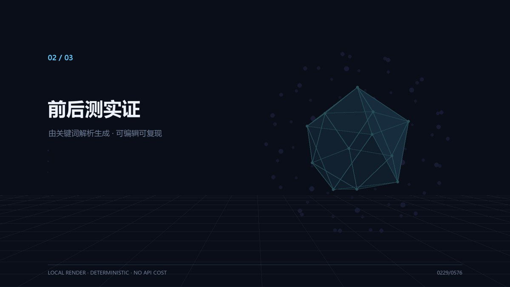

# keyword-3d-video

用关键词生成 **3D 动画风格宣传片** 的 skill。本地代码渲染，免费、可复现、字幕精确可控。

> 关键词不是喂给 AI 生成画面，而是被解析成确定性参数（配色、几何体、节奏、文案）。
> 同样的输入永远出同样的片子——不调云端视频接口，一分钱不花。

## 效果预览

一条 24 秒的样片：旋转的二十面体 + 粒子场 + 透视网格 + 四幕分镜。



## 能做什么 / 不能做什么

| 能做 | 不能做 |
|---|---|
| 科技感 3D 片头、项目宣传片、概念短片 | 写实的人物、动物、具体场景动画 |
| 关键词 → 配色/几何体/节奏自动匹配 | 剪辑你自己拍的实拍素材 |
| 字幕排版精确到像素、可复现 | 复杂叙事、逐镜头精细控制 |

后者是云端视频大模型（可灵 / 即梦 / Sora）的活，本工具走的是另一条路：**代码搭建画面**，不是 AI 凭空想象。

## 快速开始

```bash
# 依赖
pip install pillow numpy imageio-ffmpeg

# 出片
python scripts/render.py \
  --keywords "主题|要点1|要点2|要点3" \
  --style tech \
  --duration 24 \
  --out demo.mp4
```

`--style` 可选 `tech` / `edu` / `nature` / `minimal`，不填则根据关键词自动猜。
输出 1600×900、24fps、H.264 MP4。

## 作为参数化 skill 使用

把整个文件夹放进 `~/.workbuddy/skills/`，WorkBuddy 读到 `SKILL.md` 后，直接说：

> 用 keyword-3d-video 做条科技感视频，主题是 XXX，要点是 A/B/C

即可自动调用渲染。

## 原理（教学向）

两个文件，各管一层：

- `scripts/geom3d.py` — 3D 数学地基：旋转矩阵、透视投影、画家算法（遮挡），内置立方体/八面体/二十面体/粒子球。
- `scripts/render.py` — 关键词解析 → 四幕分镜 → 逐帧绘制 → RGB 字节流管道喂给 ffmpeg 编码。

核心公式只有一行：

```
screen = center + point * focal / (z + cam_z)
```

分母里的 z 造成"近大远小"，这就是 3D 感的来源。

## 自己改

| 想改什么 | 改哪里 |
|---|---|
| 配色 / 风格 | `render.py` 的 `STYLES` 字典 |
| 关键词识别 | `render.py` 的 `STYLE_HINTS` 字典 |
| 换几何体 | `geom3d.py` 加函数，或改 `STYLES[*]["shape"]` |
| 分镜节奏 | `render.py` 的 `scene_at()` |
| 字幕文案 / 排版 | `render_frame()` 里的 `draw_text` |
| 分辨率 / 帧率 | `render.py` 顶部 `W, H, FPS` |

## License

MIT
